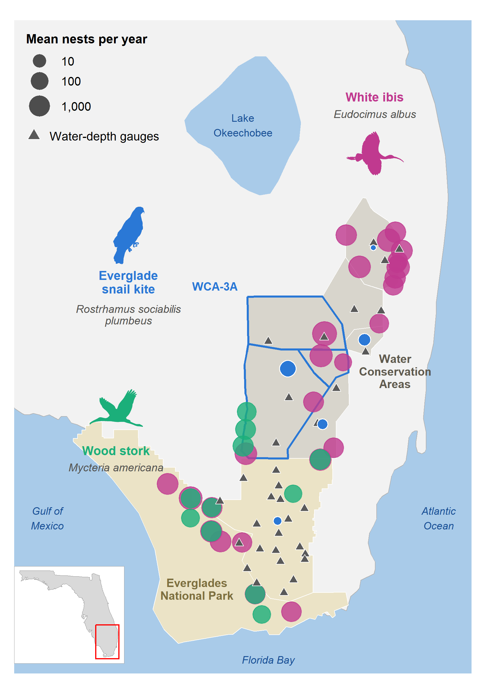
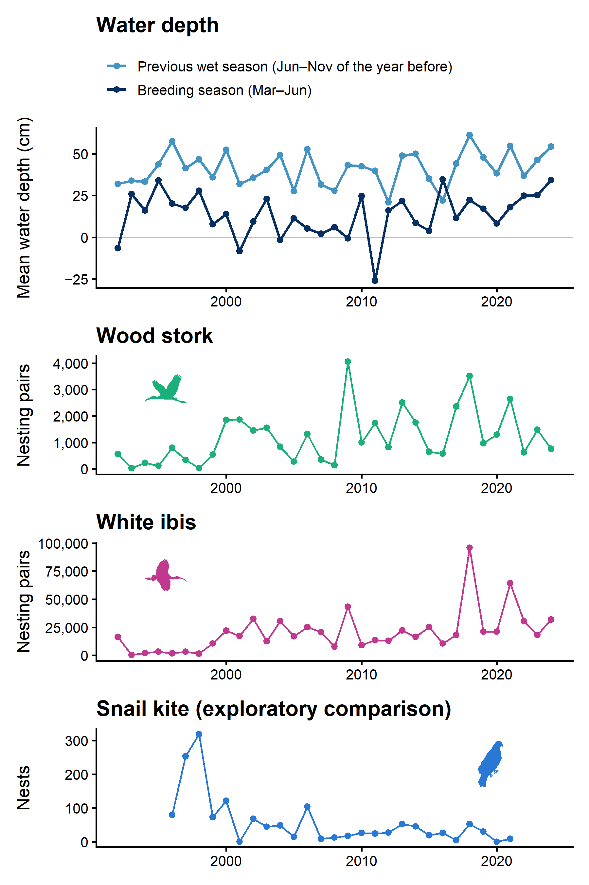
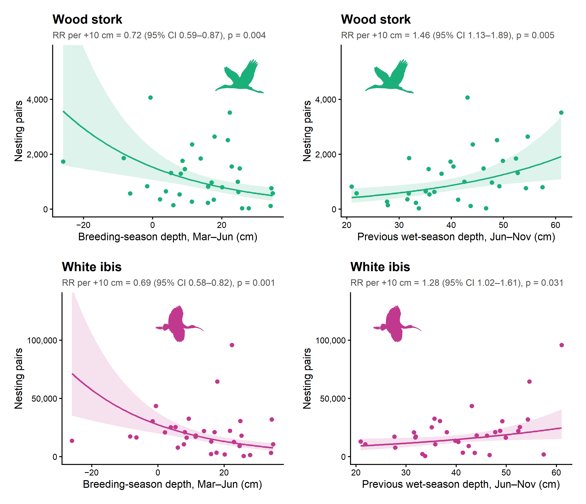
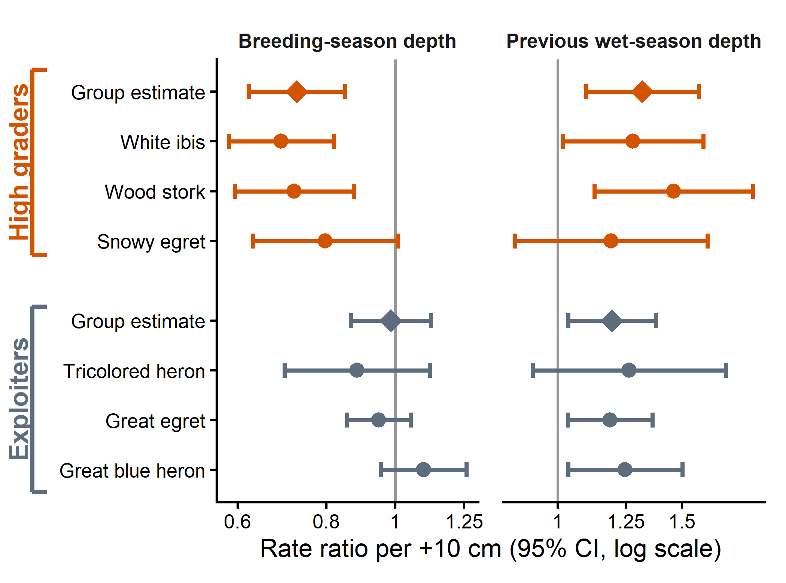
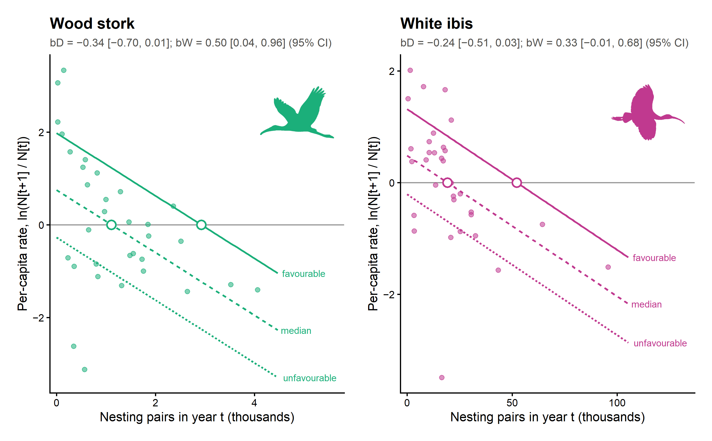
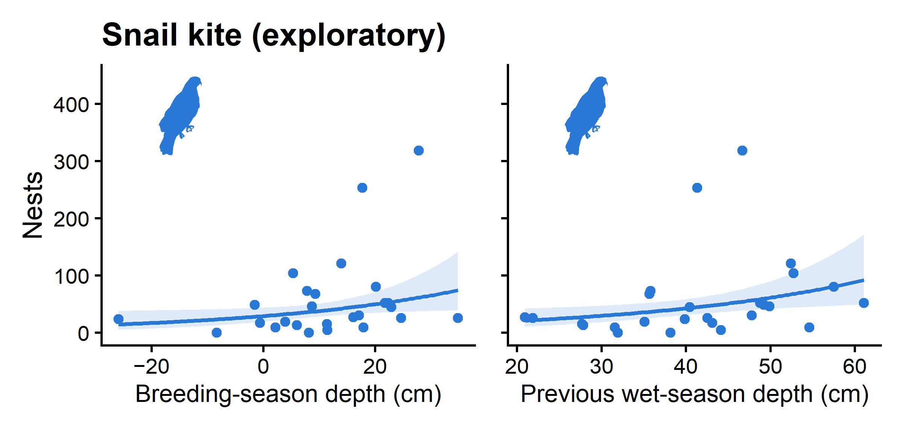
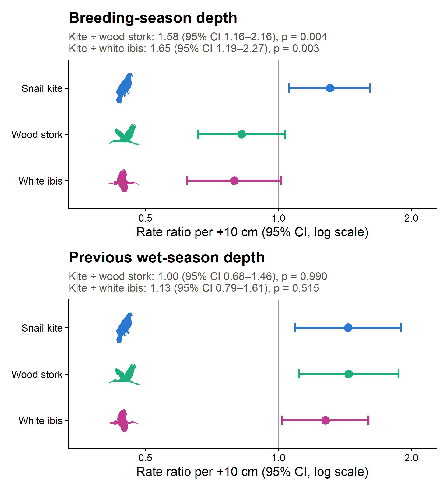
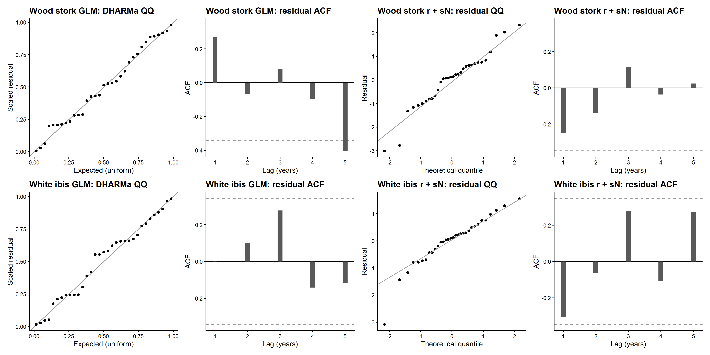
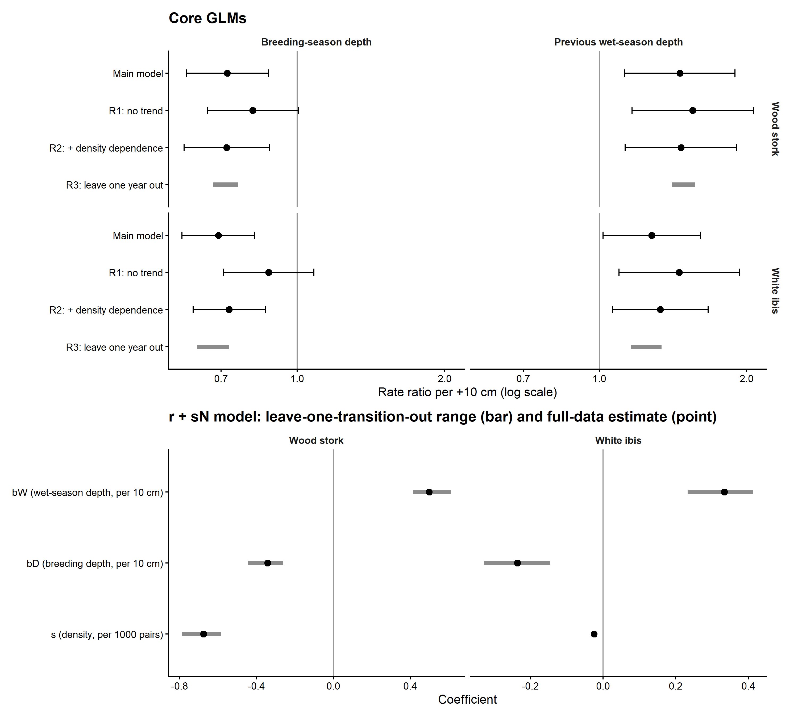

This document runs the complete analysis, from the raw data files in `data/raw/` to every number and figure.

Tables are written to `results/` and figures to `figures/`, as PNG at 300 dpi and as PDF.

**Hypotheses and predictions.** Two hypotheses are tested through five predictions; the hypotheses are stated in the README.

| Hypothesis | Prediction | Tested quantity | Analysis | Figure |
|---|---|---|---|---|
| 1 | 1a | Breeding-season depth D: rate ratio < 1 for wood stork and white ibis | 1 | F3 |
| 1 | 1b | Previous wet-season depth W: rate ratio > 1 for both species | 1 | F3 |
| 1 | 1c | r + sN model, after density dependence: b~D~ < 0 and b~W~ > 0 for both species | 3 | F5 |
| 2 | 2a | High-grader ÷ exploiter D rate ratio < 1 | 2 | F4 |
| 2 | 2b | W rate ratio > 1 in each foraging group | 2 | F4 |

An exploratory comparison with the snail kite (F6 and S3, last analysis section) is not one of these predictions.

```{r}
#| label: setup
suppressPackageStartupMessages({ library(readr); library(dplyr); library(tidyr) })
for (f in list.files("R", pattern = "\\.R$", full.names = TRUE)) source(f)
dir.create("results", showWarnings = FALSE)
dir.create("figures", showWarnings = FALSE)
show <- function(x, digits = 3) knitr::kable(x, digits = digits)
```

# Data

The analysis uses four public data sources, and a fifth for the exploratory kite comparison. Licences, citations and checksums are in `data/PROVENANCE.md`.

- **Nesting pairs.** Annual maximum nesting pairs per species from the Everglades wading-bird monitoring programme (Frederick et al. 2026, CC0). The release covers 1986–2026; 1992–2024 are used here. Region "all" is the dataset's sum of Loxahatchee NWR (WCA-1), WCA-2, WCA-3 and Everglades National Park.
- **Water stage.** Daily median water stage (cm NAVD88) at 33 EDEN gauges (12 in the Water Conservation Areas, 21 in Everglades National Park), 1991–2024.
- **Ground elevation.** Ground elevation at each gauge (Haider et al. 2024), used to convert stage to water depth.
- **Map layers.** Survey subregions and colony locations, used only in Figure 1, and species silhouettes, used in Figures 1, 2, 3, 5, 6 and S3.
- **Snail kite nests (exploratory comparison only).** Annual snail kite nests in the same wetlands, 1996–2021, from the University of Florida kite monitoring programme (Fletcher 2024, CC BY 4.0).

**Disclosure.** Predictions 1a, 1b, 2a and 2b were formalised after an exploratory analysis of the same data (October 2026), which had already shown the direction of these effects. This analysis therefore re-estimates them with a fixed specification and robustness checks set in advance; it is not an independent confirmation. Prediction 1c had not been fitted before. The five predictions were grouped under the two hypotheses after the models were fitted.

```{r}
#| label: data
stage <- read_csv("data/raw/eden_daily_stage.csv.gz", show_col_types = FALSE)
gauges <- read_csv("data/raw/eden_gauges.csv", show_col_types = FALSE)
counts <- read_csv("data/raw/wading_birds_max_count_all.csv", show_col_types = FALSE)
species_list <- read_csv("data/raw/wading_birds_species_list.csv", show_col_types = FALSE)
kite <- read_csv("data/raw/kite_nests_everglades.csv", show_col_types = FALSE)   # exploratory comparison only
show(tibble(rows_stage = nrow(stage), gauges = nrow(gauges), first_day = min(stage$date), last_day = max(stage$date)))
```

```{r}
#| label: fig-map
#| fig-cap: "Study area. Blue outline: WCA-3A. Triangles: the 33 EDEN gauges used for the water-depth index (12 in the Water Conservation Areas, 21 in Everglades National Park). Green and magenta dots: wood stork and white ibis colonies counted in at least 3 years between 1993 and 2024, with a mean of at least 50 nests per counted year. Blue dots: mean snail kite nests per year, 1996–2021, in each wetland, placed at the centre of the wetland's survey region (inland region for Everglades National Park), because kite nests are spread through a wetland and the data give no colony coordinates. Dot size on a log scale."
save_figure(fig_map(), "F1_study_area", width = 5.6, height = 8)

```

# Water-depth index

**Daily depth.** Daily depth at each gauge is stage minus ground elevation.

**Two seasonal means**, each kept for a gauge only if at least 90 % of its days have data:

- **D:** the March–June mean of the nesting year;
- **W:** the June–November mean of the year before.

**Index.** Gauges are averaged within each region, and the index is the mean of the two regions. **D10** and **W10** are D and W centred at their 1992–2024 medians and expressed per 10 cm.

```{r}
#| label: water
wi <- water_index(stage, gauges)
write_csv(wi, "results/water_index.csv")
show(tibble(years = paste(range(wi$year), collapse = "-"), n = nrow(wi),
            median_D_cm = median(wi$D), median_W_cm = median(wi$W), cor_D_W = cor(wi$D, wi$W)))
core <- prepare_counts(counts, wi, c("wost", "whib"))
```

```{r}
#| label: fig-timeseries
#| fig-cap: "Water depth and nesting, 1992–2024. Top: breeding-season (March–June) depth and the preceding wet-season (June–November of the year before) depth. Below: annual maximum nesting pairs of wood stork and white ibis, and annual snail kite nests in the same wetlands, 1996–2021 (exploratory comparison only)."
save_figure(fig_timeseries(wi, core, kite), "F2_data_overview", width = 6, height = 9)

```

# Analysis 1: core species (predictions 1a, 1b)

**Model.** For each species, a negative-binomial GLM: `pairs ~ D10 + W10 + year_c` (year_c = year − 2008).

**Reported quantities.** Rate ratios per +10 cm, with 95 % Wald CIs and likelihood-ratio tests.

**Diagnostics:**

- DHARMa simulated-residual uniformity and dispersion tests (1000 simulations, seed 20261104);
- residual autocorrelation at lags 1–5.

**Robustness checks:**

- R1: no trend;
- R2: adds log(pairs in the previous year);
- R3: leave one year out.

```{r}
#| label: core
core_models <- lapply(split(core, core$species), fit_core)[c("wost", "whib")]
core_rr <- bind_rows(lapply(names(core_models), function(s) mutate(rate_ratios(core_models[[s]]), species = s, .before = 1)))
write_csv(core_rr, "results/core_rate_ratios.csv")
show(core_rr)

core_diag <- bind_rows(lapply(names(core_models), function(s) {
  d <- core_diagnostics(core_models[[s]])
  tibble(species = s, theta = core_models[[s]]$theta, p_uniform = d$p_uniform, p_dispersion = d$p_dispersion,
         acf_lag1 = d$acf[1], acf_lag2 = d$acf[2], acf_lag3 = d$acf[3], acf_lag4 = d$acf[4], acf_lag5 = d$acf[5])
}))
write_csv(core_diag, "results/core_diagnostics.csv")
show(core_diag)

core_robust <- bind_rows(lapply(names(core_models), function(s)
  bind_rows(mutate(wald_rr(core_models[[s]]), check = "Main"), core_robustness(filter(core, species == s))) |>
    mutate(species = s, .before = 1)))
write_csv(core_robust, "results/core_robustness.csv")
show(core_robust)

# exploratory comparison only: the same model for the snail kite, 1996-2021 (results and Figure 6 in the
# last analysis section)
d3 <- kite_data(counts, kite, wi)
kite_rows <- mutate(filter(d3, species == "snki"), species = "snki")
kite_model <- fit_core(kite_rows)
```

```{r}
#| label: fig-core
#| fig-cap: "Nesting pairs against breeding-season depth (left; prediction 1a) and previous wet-season depth (right; prediction 1b), wood stork (top) and white ibis (bottom), 1992–2024. Lines: fitted negative-binomial GLM with 95 % CI, with the other water variable at its median and the year at 2008. Points: observed years."
save_figure(fig_core_effects(core_models[c("wost", "whib")], core, wi), "F3_core_effects", width = 8, height = 6.2)

```

# Analysis 2: community (predictions 2a, 2b)

**Per-species models.** The Analysis 1 model is fitted to each of the eight wading-bird species meeting the inclusion rule.

**Group test.** A negative-binomial GLMM on the six species with a foraging-type label. It estimates one D effect and one W effect per foraging group, with the following terms:

- species-specific intercepts and trends;
- a random intercept for year;
- random D and W slopes for species;
- species-specific dispersion.

The labels come from the dataset's species table. High graders (wood stork, white ibis, snowy egret) are the species that need concentrated prey; exploiters (great egret, tricolored heron, great blue heron) are the more flexible foragers (Gawlik 2002). Little blue heron and black-crowned night-heron have no label; their per-species estimates are in `results/species_effects.csv` and are not part of the group comparison.

Prediction 2a compares the high-grader and exploiter D effects with a likelihood-ratio test against a model with one common D effect.

```{r}
#| label: community
cd <- community_data(counts, wi, species_list)
sp_eff <- species_effects(cd)
write_csv(sp_eff, "results/species_effects.csv")
show(sp_eff)

cd6 <- filter(cd, !is.na(group))
gfit <- fit_group_glmm(cd6)
g_eff <- mutate(group_effects(gfit, cd6), spec_used = gfit$spec_used)
write_csv(g_eff, "results/group_effects.csv")
show(g_eff, digits = 4)
glmmTMB::VarCorr(gfit$model)
```

The GLMM specification used was **`r gfit$spec_used`**. The fallback order, set before fitting, is: full model; then no random slopes; then no year random effect. A specification counts as converged when the optimiser reports success and the Hessian is positive definite.

**Sensitivity.** The table below gives the group effects under each of the three specifications. The primary result above is the first specification that converges.

```{r}
#| label: community-sensitivity
g_sens <- group_effects_by_spec(cd6)
write_csv(g_sens, "results/group_effects_sensitivity.csv")
show(g_sens, digits = 4)
```

```{r}
#| label: fig-forest
#| fig-cap: "Rate ratios per +10 cm (95 % CI, log scale) for the six wading-bird species with a foraging-type label (circles; per-species GLMs) and for the two foraging groups (diamonds; GLMM), for breeding-season depth (prediction 2a) and previous wet-season depth (prediction 2b). Colour, row block and bracket: foraging-type label in the dataset's species table (orange, high graders, which need concentrated prey; grey, exploiters, flexible foragers). Each panel has its own axis range."
save_figure(fig_forest(sp_eff, g_eff), "F4_community_forest", width = 7, height = 5.2)

```

# Analysis 3: population dynamics in the r + sN framework (prediction 1c)

**Model.** For each core species, the per-capita rate of change over one year, g = ln(N~t+1~/N~t~), is regressed on N~t~ (thousands of pairs; coefficient s) and on the water of the nesting year: g = r + sN + b~D~D10 + b~W~W10.

**Coefficient intervals:** t-based 95 % CIs from the least-squares fit, with 28 residual degrees of freedom. These intervals are used for the decisions and for the K rule.

**Diagnostics:** residual Q–Q, residual autocorrelation and the largest Cook's distance.

**Robustness (R4):** leave one transition out.

**Equilibrium K.** K = −(r + b~D~D10 + b~W~W10)/s, computed from the fitted coefficients, for three water scenarios. The scenarios use percentiles of the 1992–2024 values (favourable: D at the 10th and W at the 90th percentile).

- **Interval:** the 2.5 and 97.5 percentiles of K over 4000 coefficient draws (seed 20261104).
- **Not defined:** K is not reported when the CI of s includes 0.
- **Negative K:** the rate is below zero at every N, so there is no positive equilibrium.

```{r}
#| label: dynamics
transitions <- lapply(split(core, core$species), make_transitions)[c("wost", "whib")]
rsn_models <- lapply(transitions, fit_rsn)
rsn_coef <- bind_rows(lapply(names(rsn_models), function(s) {
  m <- rsn_models[[s]]; ci <- confint(m)
  tibble(species = s, term = names(coef(m)), estimate = unname(coef(m)), lo = unname(ci[, 1]), hi = unname(ci[, 2]))
}))
write_csv(rsn_coef, "results/rsn_coefficients.csv")
show(rsn_coef, digits = 4)

rsn_diag <- bind_rows(lapply(names(rsn_models), function(s) {
  d <- rsn_diagnostics(rsn_models[[s]])
  tibble(species = s, n = nobs(rsn_models[[s]]), r2 = summary(rsn_models[[s]])$r.squared, p_shapiro = d$p_shapiro,
         acf_lag1 = d$acf[1], acf_lag2 = d$acf[2], max_cooks = d$max_cooks)
}))
write_csv(rsn_diag, "results/rsn_diagnostics.csv")
show(rsn_diag)

rsn_robust <- bind_rows(lapply(names(transitions), function(s)
  left_join(rsn_robustness(transitions[[s]]), select(filter(rsn_coef, species == s), term, estimate), by = "term") |>
    mutate(species = s, .before = 1)))
write_csv(rsn_robust, "results/rsn_robustness.csv")
show(rsn_robust, digits = 4)

scen <- water_scenarios(wi)
k_tab <- bind_rows(lapply(names(rsn_models), function(s) {
  m <- rsn_models[[s]]
  mutate(k_scenarios(coef(m), vcov(m), scen, df = df.residual(m)), species = s, .before = 1)
})) |>
  mutate(D_cm = D10 * 10 + median(wi$D), W_cm = W10 * 10 + median(wi$W), .after = W10) |>
  mutate(note = ifelse(is.na(K), "not defined (95 % CI of s includes 0)",
                       ifelse(K < 0, "no positive equilibrium (rate below zero at all N)", "")))
write_csv(k_tab, "results/k_scenarios.csv")
show(k_tab, digits = 2)
```

```{r}
#| label: fig-rsn
#| fig-cap: "Per-capita rate of change against nesting pairs (thousands) for wood stork and white ibis (prediction 1c; the coefficients b~D~ and b~W~ are in the decision summary). Lines: fitted r + sN model under the favourable, median and unfavourable water scenarios. Open circles: equilibrium K, where a line crosses zero (shown only when K is positive and inside the plotted range)."
save_figure(fig_rsn(transitions, rsn_models, k_tab), "F5_rsn_dynamics", width = 8, height = 4.8)

```

# Decision summary

Each prediction is classified with rules set before the final models were fitted:

- **Supported:** the 95 % CI lies entirely on the predicted side of 1 (rate ratios) or 0 (coefficients).
- **Contradicted:** the CI lies entirely on the other side.
- **Not supported:** anything else.
- **Prediction 1c, combined outcome per species:** "contradicted" if either coefficient is contradicted; otherwise "supported" if both b~D~ and b~W~ are supported, "partly supported" if one is, and "not supported" if neither is.
- **Robust:** the direction of the effect is unchanged in every robustness estimate, i.e. R1–R3 for Analysis 1 and R4 for Analysis 3. It is not defined for predictions 2a and 2b.

```{r}
#| label: decisions
core_rob <- core_robust |>
  filter(check != "Main") |>
  group_by(species, term) |>
  summarise(robust = robust_direction(rr, ifelse(term[1] == "D10", "below", "above")), .groups = "drop")
rsn_rob <- rsn_robust |>
  filter(term != "N_t") |>
  rowwise() |>
  mutate(robust = robust_direction(c(min, max), ifelse(term == "D10_next", "below", "above"), null = 0)) |>
  ungroup() |>
  select(species, term, robust)
core_dec <- left_join(core_rr, core_rob, by = c("species", "term"))
rsn_dec <- rsn_coef |>
  filter(term %in% c("D10_next", "W10_next")) |>
  left_join(rsn_rob, by = c("species", "term"))
decision <- decision_summary(core_dec, g_eff, rsn_dec)
write_csv(decision, "results/decision_summary.csv")
show(decision)
```

# Exploratory comparison: snail kite

**Status.** This comparison is not one of the five predictions. It was added on 6 November 2026, after the results above were known, to compare the two wading birds with the snail kite, which nests in the same wetlands. Its specification was fixed before it was fitted. It is reported as exploratory, and it is not part of the decision summary.

**Data.** Annual snail kite nests in Loxahatchee NWR (WCA-1), WCA-2, WCA-3 and Everglades National Park, 1996–2021: the number of different nests in the nest-monitoring file of Fletcher (2024). These are the wetlands of the wading-bird counts.

**Models:**

- the Analysis 1 model (negative-binomial GLM with D10, W10 and a trend), fitted to the kite counts, with the same diagnostics;
- one negative-binomial model for kite, wood stork and white ibis over 1996–2021. It has an intercept, a trend, a D effect and a W effect for each species, a year random effect shared by the three species and a dispersion parameter for each species. If it does not converge, the year effect is dropped.

**Comparison.** The kite's rate ratio divided by each wading bird's rate ratio, for D and for W, with Wald 95 % CIs and p-values from the joint model.

```{r}
#| label: kite
kite_rr <- rate_ratios(kite_model)   # kite_model and d3 come from the Analysis 1 chunk
write_csv(kite_rr, "results/kite_rate_ratios.csv")
show(kite_rr)

kd <- core_diagnostics(kite_model)
kite_diag <- tibble(theta = kite_model$theta, p_uniform = kd$p_uniform, p_dispersion = kd$p_dispersion,
                    acf_lag1 = kd$acf[1], acf_lag2 = kd$acf[2], acf_lag3 = kd$acf[3], acf_lag4 = kd$acf[4], acf_lag5 = kd$acf[5])
write_csv(kite_diag, "results/kite_diagnostics.csv")
show(kite_diag)

kfit <- fit_kite_joint(d3)
k_eff <- mutate(kite_effects(kfit), spec_used = kfit$spec_used)
write_csv(k_eff, "results/kite_comparison.csv")
show(k_eff)
```

The joint-model specification used was **`r kfit$spec_used`**.

```{r}
#| label: fig-kite-glm
#| fig-cap: "Exploratory comparison: snail kite nests against breeding-season depth (left) and previous wet-season depth (right), 1996–2021, with the Analysis 1 model. Lines: fitted negative-binomial GLM with 95 % CI, with the other water variable at its median and the year at 2008. Points: observed years."
save_figure(fig_core_effects(list(snki = kite_model), kite_rows, wi), "F6_kite_glm", width = 8, height = 3.8)

```

```{r}
#| label: fig-kite
#| fig-cap: "Figure S3. Exploratory comparison, 1996–2021. Rate ratios per +10 cm (95 % CI, log scale) for snail kite, wood stork and white ibis from one negative-binomial model, for breeding-season depth (top) and previous wet-season depth (bottom). Subtitles: the kite's rate ratio divided by each wading bird's."
save_figure(fig_kite(k_eff), "S3_kite_comparison", width = 6.4, height = 7)

```

# Supplementary figures

```{r}
#| label: supp-diagnostics
#| fig-cap: "Figure S1. Diagnostics. For each core species: DHARMa Q–Q plot and residual autocorrelation of the GLM; residual Q–Q plot and autocorrelation of the r + sN model. Dashed lines: approximate 95 % bounds for zero autocorrelation."
save_figure(fig_diagnostics(core_models, rsn_models), "S1_diagnostics", width = 14, height = 7)

```

```{r}
#| label: supp-robustness
#| fig-cap: "Figure S2. Robustness. Top: rate ratios of the core GLMs in the main model and in checks R1–R2 (points with 95 % CI), and the range over the 33 leave-one-year-out refits (R3, grey bar). Bottom: r + sN coefficients (points) and their range over the leave-one-transition-out refits (R4, grey bars)."
save_figure(fig_robustness(core_robust, rsn_robust), "S2_robustness", width = 10, height = 9)

```

# Computational environment

Package versions are fixed in `renv.lock`. To restore them, run `renv::restore()`.

```{r}
#| label: session
sessionInfo()
```
